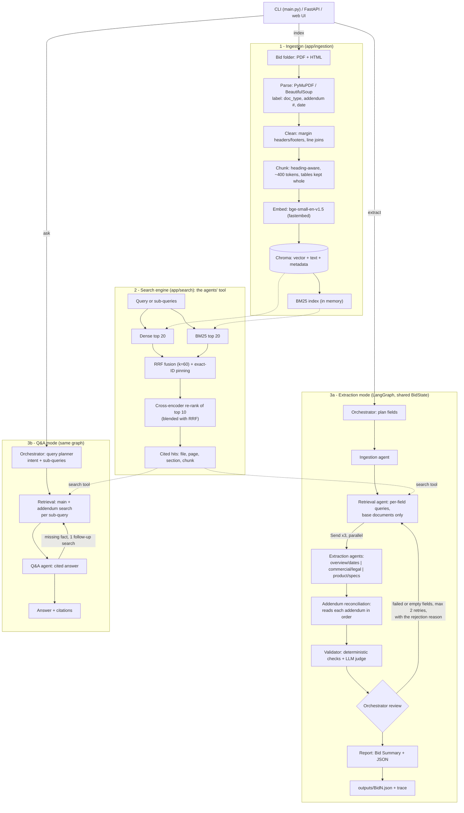

# RFP Intelligence Platform

**Demo video:** [watch on Google Drive](https://drive.google.com/file/d/1kofiUmyEYLxVPA6ry9ANQKr2XrihD7oD/view?usp=sharing)

A RAG search engine over procurement bid documents (PDF and HTML, including addenda) and a LangGraph
multi-agent system that uses it as a tool to:

- **extract** a 20-field JSON record per bid folder, every value cited to a file, page and quote, with
  addendum changes applied and a validation status per field;
- **answer** free-form questions with numbered citations.

Everything runs locally except the LLM calls (Anthropic Claude). Embeddings, the vector store, BM25 and
the cross-encoder re-ranker need no API key.

| Deliverable | Where |
|---|---|
| Extraction outputs | [outputs/Bid1.json](outputs/Bid1.json), [outputs/Bid2.json](outputs/Bid2.json) |
| Retrieval evaluation | [eval/report.md](eval/report.md), question set [eval/eval_set.json](eval/eval_set.json), notes [eval/eval_set_notes.md](eval/eval_set_notes.md) |
| Q&A log (13 questions) | [outputs/qa_log.md](outputs/qa_log.md) |
| Full agent trace of one extraction | [outputs/traces/extract_Bid1.jsonl](outputs/traces/extract_Bid1.jsonl) |
| Side-by-side bid comparison | [outputs/comparison.md](outputs/comparison.md) |
| Architecture diagram | [below](#architecture) |

---

## Quick start

Requires Python 3.11 (3.10+ works) and an Anthropic API key.

```bash
python -m venv .venv
.venv\Scripts\activate            # Windows   (Linux/macOS: source .venv/bin/activate)
pip install -r requirements.txt
cp .env.example .env              # then put your ANTHROPIC_API_KEY in .env

python main.py extract --bid ./data/Bid1      # the one command: index (incremental) + extraction
```

The first run downloads the two ONNX models (about 190 MB in total) and indexes the
folder; later runs skip unchanged files. `python main.py --bid ./data/Bid1` works too (shortcut for `extract`).

### Docker

```bash
docker compose up --build                     # API on http://localhost:8000 (Swagger at /docs), web UI on :8501
docker compose run --rm api python main.py extract --all          # one-shot extraction of every folder in data/
```
The image bakes in both models, so the container needs no download at run time. `data/`, `index/` and
`outputs/` are mounted from the host; the API key comes from `.env`. Both ports are published on `127.0.0.1` only,
so the API (which spends the API key) is not reachable from the network.

### Tests

```bash
pytest -q          # 115 tests, no network: fake LLM, embedder, re-ranker and API
ruff check . && ruff format --check .
```
CI ([.github/workflows/ci.yml](.github/workflows/ci.yml)) runs on every push, in two jobs: **tests** (lint + pytest)
and **retrieval-eval**, which indexes both bids, runs the evaluation below and fails if the hybrid + re-rank MRR drops
under 0.70 (`python main.py eval --min-mrr 0.70`). The results table appears on the run page and the full report is
attached. Neither job needs an API key.

---

## How to run each mode

| Mode | CLI | API |
|---|---|---|
| Index | `python main.py index --bid ./data/Bid3` (or `--all`, `--force`) | `POST /index` `{"folder": "data/Bid3"}` or `{"all": true}` |
| Search (no LLM) | `python main.py search "210-BLYZ" --bid Bid2 --top-k 5 --mode hybrid_rerank` | `GET /search?q=210-BLYZ&bid_id=Bid2&top_k=5` (also `doc_type`, `addendum_number`, `mode`) |
| Extraction | `python main.py extract --bid ./data/Bid1` (or `--all`) | `POST /extract` `{"bid_id": "Bid1"}` or `{"folder": "data/Bid1"}` |
| Q&A | `python main.py ask "What changed in Addendum 2?"` | `POST /ask` `{"question": "..."}` |
| Evaluation | `python main.py eval` → `eval/report.md` | |
| Q&A log | `python -m eval.qa_log` → `outputs/qa_log.md` | |
| Saved record | | `GET /records/Bid1` (the last extraction, without running it) |
| Comparison | `python main.py compare` (or `--bid Bid1 --bid Bid2`) → `outputs/comparison.md` | `GET /compare?bid_id=Bid1&bid_id=Bid2` |
| Server | `python main.py serve` | `GET /health` |
| **Web UI** | `python main.py ui` (with `serve` running) → http://localhost:8501 | |

```bash
curl "http://localhost:8000/search?q=bid%20bond&bid_id=Bid1&top_k=3"
curl -X POST http://localhost:8000/ask -H "content-type: application/json" \
     -d '{"question": "Compare the warranty requirements of both bids."}'
```

### Web UI
A Streamlit page with four tabs: **Ask** (chat with cited answers, sources and answer checks), **Search** (raw
retrieval with bid, document-type and mode filters, showing file, page and re-rank score), **Extracted bids** (the
20 fields with status, confidence and sources, the addendum changes, run cost, and a button to re-run the
extraction) and **Compare** (the side-by-side report). It only calls the REST API (`RFP_API_URL`), so the UI, CLI and API share one pipeline. Swagger at
`/docs` remains the developer view of the same endpoints.

**A new bid** needs no code change: put its files in `data/<BidName>/` and run `extract --bid ./data/<BidName>`.
`bid_id` is the folder name. This was tested by copying Bid2 to a new folder with neutral file names
(`Main_Document.pdf`, `Attachment_A.pdf`, `listing.html`, …) inside a clean container: the record matched Bid2.

---

## Architecture



One `Runtime` object (`app/runtime.py`) builds the settings, search engine and LLM client once; the CLI and the
API both use it, so they behave identically.

---

## Design decisions

### Parsing (`app/ingestion/`)
- **PDF: PyMuPDF.** Page-accurate text in the PDF's own block order, so label/value pairs on form-style pages
  stay together. Real data tables (detected with `find_tables`) become Markdown, with cell text rebuilt from the
  page's words because the table extractor mangled values such as `210-BLYZ`. Layout-only "tables" fall back to
  plain text.
- **HTML: BeautifulSoup.** Navigation, scripts, cookie banners and forms are removed. The BidNet pages are built
  from `div` label/value pairs (no `<table>`), so short label nodes followed by a value are detected generically
  and rendered as `Closing Date: 07/09/2024 03:00 PM EDT`.
- **Labels (`detect.py`)** are generic regex rules over file name and first-page text: `doc_type`
  (bid_page / rfp / addendum / specs / affidavit / form / other), addendum number, document date.
- **Cleaning.** Repeated headers and footers are removed only from blocks in the top/bottom 12% of the page
  (an earlier "repeated line anywhere" rule deleted body text). Broken lines are joined, but `Label: value` lines
  are kept apart.
- Pages with almost no text are flagged as empty or scanned in the ingest report (no OCR).
- **Incremental indexing:** a SHA-256 manifest per file; unchanged files are skipped, changed files have their old
  chunks deleted first.

### Chunking
Heading-aware chunks of about **400 tokens (max 600) with 60 tokens of overlap**, never crossing a page, so every
chunk has one exact page for citation. RFPs are structured (numbered sections, Q&A in addenda, tables), so
splitting at headings keeps one requirement or one answered question per chunk. 400 tokens gives the re-ranker and
the LLM enough context while keeping prompts small. Tables are kept whole, or split by rows with the header repeated,
and placed where they sit on the page so they carry the right section; small form tables (about 100 tokens) stay
inside their paragraph instead of becoming tiny chunks of their own. A heading never forms a chunk on its own.
Each chunk's stored text starts with a context line, `[Bid1 | Addendum 2 | p.1 | Section: …]`, which helps both
BM25 and the embedder.

### Embeddings and storage
**BAAI/bge-small-en-v1.5 via fastembed** (384 dimensions, ONNX): local, free, no PyTorch, small Docker image, and
strong for its size. **Chroma** (persistent, cosine) stores vector, text and metadata together and supports metadata
filters (`bid_id`, `doc_type`, `addendum_number`), so no separate database is needed. Embeddings are computed by
our own embedder, never by Chroma.

### Retrieval: hybrid + pinning + re-ranking
1. **Dense** (Chroma) and **BM25** (`rank_bm25`) each return 20 candidates. The BM25 tokenizer keeps identifiers
   both whole and split (`210-BLYZ` → `210-blyz`, `210`, `blyz`), so exact part numbers match.
2. **Reciprocal Rank Fusion**, `Σ 1/(60 + rank)`: merges the lists without calibrating two different score scales.
3. **Pinning:** if the query contains an ID-like token (digits plus letters or a separator), chunks containing that
   exact token are moved to the front of the candidate list (only the chunk body, not file names; at most 10).
4. **Cross-encoder re-ranking** (`Xenova/ms-marco-MiniLM-L-12-v2`) of the top 10. Its score is blended with the RRF
   rank, because on its own it sometimes ranked form-like contact blocks very low.

The eval decided each of these choices: the smaller MiniLM-L-6 re-ranker made results worse than plain hybrid, and
L-12 with 10 candidates plus the RRF blend made them better.

### Query planning (Q&A)
The fast model turns a question into an intent (`bid_question`, `compare`, `chitchat`, `out_of_scope`) and up to 4
sub-queries, each with rewritten search phrases, exact keywords and a bid filter chosen from the indexed bids'
titles and issuers (read from the index, not hard-coded). A compare question gets one sub-query per bid. A question
about an addendum change also gets a sub-query for the original value. If the call fails, a rule-based fallback
uses `synonyms.yaml` and matches bid IDs and title words.

### Addendum handling
Addenda are handled twice, deliberately:
- **Q&A:** every sub-query runs a second search restricted to `doc_type=addendum` (2 hits, or 1 per sub-query when
  there are several), so a one-line change is never crowded out by long RFP passages.
- **Extraction:** fields are first extracted from the **base documents only**. The **Reconciliation agent** then
  reads **every addendum in full, in order** (by addendum number, then date) and decides per field:
  - `override`: the addendum explicitly replaces the value ("The new due date for this RFP will be July 9, 2024…");
  - `clarification`: it narrows or adds information (e.g. minimum warranty periods), or fills a field the base
    documents left empty.

  A statement of intent ("does not anticipate extending the deadline") is not a change. Every change is recorded
  in `addendum_changes` with old value, new value and source. Reading whole addenda (2 calls for Bid1) costs less
  than searching them per field and cannot miss a change.

### Agents and orchestration (LangGraph)
LangGraph gives a typed shared state with reducers (parallel extraction groups merge their results safely),
conditional edges for the retry loop, `Send` for the parallel fan-out, and one place to wrap every node for tracing
and error handling. LangChain is not used.

| Agent | Role | LLM |
|---|---|---|
| Orchestrator | Q&A: plans the query. Extraction: lists the fields; in review, decides which fields go back for another round and when to stop | fast model (planner only) |
| Ingestion | Indexes the folder (incremental) | – |
| Retrieval | Builds one query per field from `fields.yaml` (question + hints; synonyms on retry), top 6 (10 on retry), at most 4 chunks per file so one long document can't fill the evidence, plus the first chunks of each document as shared context. A field can exclude document types (the documentation field skips the blank forms' own text, which crowded out the solicitation's requirements) | – |
| Extraction ×3 | One per field group, in parallel. Fills values only from numbered evidence, with citations, verbatim quotes, confidence and notes | strong |
| Reconciliation | Applies addendum overrides and clarifications (above) | strong |
| Validator | Checks every field (below); a batched LLM judge for the free-text fields | fast (judge) |
| Q&A / Report | Q&A: cited answer, may ask for one follow-up search; quotes and facts are checked against the cited passages. Extraction: the Bid Summary (written only from fields that passed) and the JSON file | strong |

**Feedback loop:** the Validator sends failed fields back with the reason ("time 00:00 is not stated in the cited
text"). The next round searches wider and the extraction prompt includes "Previous answer rejected because …".
A field that comes back empty the first time gets one wider search before it is accepted as not found. After two
retries the best attempt is kept as `failed` with its reasons; a failed field is never shown as passed. Fields that
passed are frozen.

### Prompts (`app/agents/prompts.py`)
All prompts are in one module. The rules they share: use only the numbered evidence; return null with
"Not found in documents" instead of guessing; cite evidence numbers and copy the quote verbatim; generic
boilerplate is not a requirement; keep the documents' spelling and contradictory labels; dates as
`YYYY-MM-DD HH:MM TZ` in the zone the source states, never placeholder times; answers, notes and summaries write
every date the same way (`DATE_STYLE`), while quotes stay verbatim. Field questions, hints and formats
live in `fields.yaml`; the code only loops over it.

### Structured outputs
Every LLM call returns a Pydantic model through the Anthropic SDK's structured outputs (`messages.parse` with the
model class as output format), so the response is schema-valid JSON without parsing free text. (Forced tool use was
the first plan; it is rejected by the current models while thinking is on.) A validation error triggers one repair
attempt with the error message. Transport errors retry with backoff. The LLM returns evidence **numbers**; code maps
them to file, page and chunk, so a citation can't point at a passage that wasn't in the prompt.

### Validation and confidence (`validator_agent.py`)
Deterministic checks first, then the judge:
1. The value has a citation, the cited chunk exists, and the quote is really in it (fuzzy ratio ≥ 90).
2. Format by type: datetime parses and matches `YYYY-MM-DD HH:MM TZ`; a contact has an email or phone; a list is a list.
3. Key facts of the value (emails, phones, dates, IDs, numbers) appear in the cited text. Dates are compared as
   dates, phones as digits, and `128 GB` matches `128GB`.
4. A time in a datetime value must be written in the cited text (this caught an invented `00:00`).
5. The value equals the latest addendum change for that field.
6. The LLM judge (fast model) reads the full cited passages for the free-text fields (submission type, term,
   installation, payment terms, specification): yes / partial / no, where "no" also covers a value that is
   supported but does not answer the field's question (e.g. a funding source offered as payment terms).

Failures send the field back; warnings only lower confidence. **Confidence** starts from the extractor's own
estimate, +0.05 when two different documents support it (cap 0.99) or ×0.9 for a single source, ×0.6 with any
warning, capped at 0.3 if failed. Not found gets 0.8 after the wider search confirmed it (0.6 otherwise). An
addendum override raises the starting estimate to 0.9 before these adjustments. Before the JSON is written, any
quote that doesn't match its chunk is replaced by the chunk's own text.

**Q&A answers** get the same deterministic checks without the retry loop: each quote must be in its passage
(otherwise the passage's closest line is shown), and the numbers, dates, IDs, e-mails and phones of each sentence must
appear in the passages that sentence cites (a sentence without a marker: in any passage the answer cites, including
the file name in its header). Failures come back as `warnings` in the response, in the CLI and in the Q&A log.

### Error handling
- Every agent node is wrapped: an exception becomes an entry in `errors` plus that agent's fallback (for example,
  its fields are marked failed with the reason), and the run continues.
- If the graph itself breaks, the runtime still writes a complete JSON with every field failed and the error.
- One unreadable file never stops ingestion. Empty retrieval leads to "not found", not to a guess, but a search
  that **fails** is reported as a failure ("the documents could not be searched …") and never as "not found"; a
  failed follow-up search ends the follow-up loop.
- In the API, an LLM failure in `/ask` or `/extract` returns HTTP 503 with the reason.

### Observability
Each run writes a JSONL trace with one line per agent step (input and output summary, duration, status), each
search call (queries, filters, hit count, ms), each LLM call (model, tokens, latency) and each decision (what the
validator rejected, which addendum changed what). The console shows one progress line per agent. Each record's
`run_info` has the token and cost totals, the duration and the retried fields.

**Cost per run** (`claude-sonnet-5-5` strong, `claude-haiku-5-5` fast): Bid1 about $0.24 and 55–75 s (11 calls,
two rounds); Bid2 about $0.15 and 40–50 s (8–9 calls). A Q&A question costs about 1–2 cents.

---

## Evaluation

27 questions over both bids ([eval/eval_set.json](eval/eval_set.json)): dates (including the addendum change), IDs
and part numbers, contacts, submission, warranty, forms, delivery, contract vehicles, a table spec, a BidNet-only
fact, the term, payment, a multi-topic question, and 2 questions with no answer in the documents. Expected passages
are matched by file + page + text substring, so the labels survive re-chunking. Every expected passage was checked
against the PDFs.

| Configuration | Recall@1 | Recall@3 | Recall@5 | Recall@10 | MRR@10 | Avg latency |
|---|---|---|---|---|---|---|
| vector | 0.52 | 0.76 | 0.84 | 0.92 | 0.658 | 9 ms |
| hybrid (dense + BM25 + RRF) | 0.52 | 0.84 | 0.88 | 1.00 | 0.689 | 9 ms |
| **hybrid_rerank** (+ pinning + cross-encoder) | **0.60** | **0.92** | **0.92** | **1.00** | **0.758** | 860 ms |

Reproduce with `python main.py eval`. BM25 fixes exact identifiers (vector search misses `210-BLYZ` entirely), and
the re-ranker moves the right passage up (MRR +0.07). The report also has a per-question rank table.

**Second, independent query set.** Before the demo a separate review wrote 61 more queries (misspellings, vague
wording, table rows, BidNet-only facts, filters) and located every answer in the documents by hand. With
hybrid + re-rank, 47 are answered at rank 1 and 60 in the top 5 (MRR 0.869); vector search alone gets 31 and 46.
That review also led to two chunking fixes (tables kept with the section they belong to, no heading-only chunks),
which cut the index from 245 to 214 chunks and removed 21 duplicate stub chunks.

**Not-found threshold:** the score distributions of relevant and irrelevant passages overlap on this set (on-topic
but non-answering passages score high, and correct answers in tables or misspelled queries score as low as −10.8),
so the threshold is set to −12, below every correct answer, and only flags sub-queries with no plausible evidence. Not-found decisions are made by the LLM from the evidence and enforced by the validator, not by a score
cut-off.

### Extraction results

| Bid | Passed | Failed | Not found | Notes |
|---|---|---|---|---|
| Bid1 (Dallas ISD) | 16 | 0 | 4 | Due date **2024-07-09 14:00 CST** from the Addendum 2 override (original 2024-06-27 noted); Addendum 1's "does not anticipate extending" correctly ignored. Bid bond, payment terms, model and part numbers honestly not found (the specs are minimum tiers; the vendor proposes the model). |
| Bid2 (MD Treasurer) | 16 | 0 | 4 | PORFP `E20P4600040` (eMMA `BPM044557` in notes); due 2024-06-10 14:00 EDT (date from the PORFP, time from the portal page, both cited). Term, pre-bid meeting, installation and bid bond are not stated in the documents. |

### Q&A
[outputs/qa_log.md](outputs/qa_log.md): the brief's 5 example questions plus 8 more (a part number, contacts,
submission, delivery and payment, contract vehicles, the pre-bid meeting, a greeting, an off-topic question). All
5 brief questions are answered correctly with citations, and all 13 answers in the current log are correct with no
check warnings. In an earlier run the answer checks caught a real slip: an outside example ("State payment within
30 days") that no cited passage contains.

---

## Bonus features (brief §12)

| Bonus | Status |
|---|---|
| Docker + CI that runs the tests **and the retrieval evaluation** | Done: `docker compose up` (API + UI); GitHub Actions runs lint + 115 tests and a retrieval-eval job that fails if MRR drops below 0.70 |
| Web UI for search and chat | Done: Streamlit, four tabs (above) |
| Bid comparison report | Done: `main.py compare` / `GET /compare` / UI tab, built from the saved records with no LLM. Q&A also handles comparison questions (`compare` intent: one sub-query per bid) |
| Cost and latency tracking per run | Done: every LLM call is traced with model, tokens and latency; each record's `run_info` has calls, tokens, **cost in USD** (prices per model in `config.yaml`) and duration; the Q&A log shows latency and cost per question; the CLI prints them after each run |
| OCR, go/no-go recommendation, semantic caching | Not done. Scanned pages are detected and reported; the two bids have a full text layer |

---

## Assumptions

- `bid_id` is the folder name; one folder is one bid.
- Citations use the **physical** PDF page (1-based); the printed page label is kept as extra metadata. HTML
  citations give the section heading and `page: null`.
- Dates are `YYYY-MM-DD HH:MM TZ` in the time zone the cited document states; conversions go in notes. If the
  solicitation gives only a date and the portal page gives the time for that date, both are cited.
- When a bid has several identifiers, the value is the solicitation code of the main solicitation document (a
  lettered code over a purely numeric sourcing number); the others are listed in notes.
- List fields (`Model_no`, `Part_no`, `Product`, `Any Additional Documentation Required`) are JSON lists.
- `null` with "Not found in documents" means not found after a wider second search. A field is "None" or
  "Not required" only if a document says so.
- Q&A is single-turn (no conversation memory).
- The submission deadline (Mon 26 Oct 2026, 1:00 PM) is read as IST.

## Known limitations

- **No OCR.** Pages without a text layer are detected and reported but not read. In Bid1 this happens on RFP
  pp.54–59, a blank IRS W-9 form whose text is drawn as vector outlines; nothing bid-specific is lost there (the
  requirement to submit a W-9 is ordinary text on p.33 and is extracted).
- **Q&A answers are checked but not retried.** Every quote is verified against its passage and the key facts of
  every sentence (numbers, dates, IDs, e-mails, phones) against the passages it cites; problems are returned as
  `warnings` with the answer, without another LLM round. The check is lexical: a wrong claim without numbers or IDs
  (an over-stated sentence) is not caught.
- **The not-found threshold is not discriminative** on a 27-question set; a larger labelled set would be needed to
  calibrate it.
- **Confidence on long free-text fields is modest (0.4–0.6)**, because the judge often rates multi-fact summaries
  "partial". This is by design (conservative), but it makes those scores less informative.
- **No automatic cross-source time check:** the system does not compute that BidNet's 3:00 PM EDT equals the RFP's
  2:00 PM CST; the model explains such agreements in notes.
- **Document-type detection relies on keywords:** a quote sheet with a neutral file name and no "quote/spec" wording
  is labelled `form`. Extraction is unaffected (it only separates addenda from base documents).
- **LLM output varies between runs:** values are stable on these bids, but wording, notes and confidence move
  slightly.
- HTML pages have no page numbers. Re-ranking runs on CPU (~0.9 s per search).
- **Folder housekeeping is basic:** deleting a whole bid folder leaves its chunks in the index (files deleted inside a
  folder are cleaned up), nested subfolders are ignored, and the same file under two names is indexed twice.

---

## Project structure

```
main.py                    CLI: index / extract / ask / search / eval / compare / serve / ui
config.yaml                every tunable setting (chunk sizes, top-k, models' parameters, retries, prices)
fields.yaml                the 20 fields: group, type, question, hints, format
synonyms.yaml              generic procurement vocabulary for query expansion
app/
  config.py  models.py     typed settings; shared Pydantic models (Chunk, SearchHit, FieldResult, BidRecord, …)
  comparison.py            side-by-side Markdown report from the saved records
  llm_client.py            Anthropic structured outputs, retries, token/cost tracking, trace logging
  logging_utils.py         JSONL trace logger
  runtime.py               composition root shared by CLI and API
  ingestion/               detect, pdf_parser, html_parser, cleaning, chunker, pipeline (manifest)
  search/                  embedder, vector_store, bm25_index, fusion, reranker, query_planner, engine
  agents/                  state, base (node wrapper), orchestrator, ingestion/retrieval/extraction/
                           reconciliation/validator/report agents, evidence, prompts, graph
  api/server.py            FastAPI: /health /index /search /ask /extract /records
  ui/streamlit_app.py      web UI: chat, search, extracted records (a client of the API)
eval/                      eval_set.json, run_eval.py, report.md, qa_log.py
tests/                     115 tests: parsing, chunking, tokenizer, fusion, engine, planner, LLM client,
                           validator, API, web UI, full graph with a fake LLM
outputs/                   BidN.json, comparison.md, qa_log.md, traces/
data/                      Bid1, Bid2 (input folders)
```

The brief's module names (`ingestion/`, `search/`, `agents/`, `api/`) are sub-packages of `app/`, so imports read
`from app.search.engine import SearchEngine`.

**Main dependencies:** anthropic 2.3, langgraph 1.2, chromadb 1.5, fastembed 0.9, pymupdf, beautifulsoup4 + lxml,
rank-bm25, rapidfuzz, fastapi + uvicorn, pydantic 2 (all pinned in `requirements.txt`).

## AI assistance

Built with the help of an AI coding assistant (Claude Code). All design decisions were reviewed and are understood
by the author, who can explain every module.
